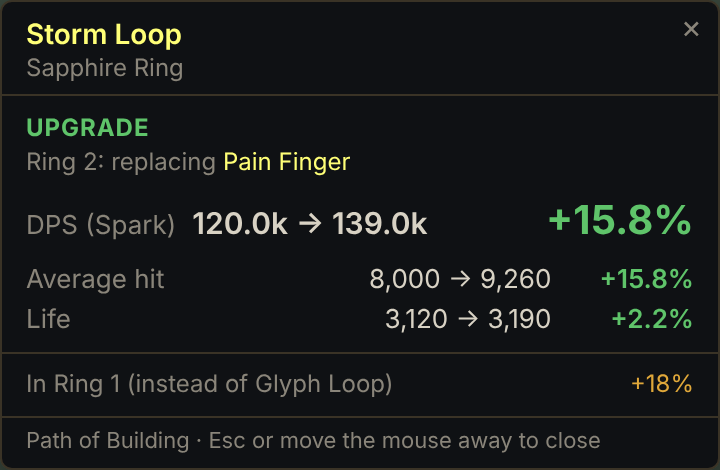

# PoE2 Item Checker

Hover an item in **Path of Exile 2**, press **F2**, and a small popup next to your mouse shows what
that item does to **your build**: DPS before → after with the percentage, effective HP, life,
energy shield, resistances, Spirit and more. The numbers come from **Path of Building**'s own
calculation engine, running locally on your PC.

<p align="center"></p>

## Use it

1. Download `PoE2-Item-Checker-Setup-x.y.z.exe` (or the Portable .exe) from
   [Releases](../../releases) or from the latest [Build](../../actions) run, and start it.
   Windows may warn because the installer isn't code-signed: *More info → Run anyway*.
2. The settings window opens. In Path of Building: *Import/Export Build → Generate*, then paste the
   code (or a pobb.in link) and press **Load build**.
3. In PoE2 set **Options → Graphics → Windowed Fullscreen**, so the popup can show over the game.
4. Hover an item and press **F2**. Esc, or moving the mouse away, closes the popup.

The app lives in the system tray; click the tray icon for settings. The hotkey can be changed there.

### What the popup shows

- **Verdict:** UPGRADE / DOWNGRADE / MIXED / NO CHANGE.
- **DPS** of your main skill (or Full DPS / minion DPS when your Path of Building build uses those),
  before → after and the change in %.
- Every stat that changes: average hit, attack/cast rate, crit, effective HP, life, ES, mana,
  Spirit, armour, evasion, block, movement speed, resistances, attributes.
- **Warnings:** a resistance dropping below its maximum, not enough Spirit, attributes too low to
  wear it.
- For rings (and anything that fits more than one slot), the best slot first, the others below.
- Flasks and charms: what having them active changes.

## Fair play and privacy

- The app's **only input to the game is one Ctrl+C per hotkey press**, sent only when the game is
  the active window: exactly what you would press yourself to copy the item. It never reads game
  memory or game files and never injects anything.
- Your clipboard is put back the way it was right after the item is read.
- Your build and settings stay on your PC (`%APPDATA%\PoE2 Item Checker`). The only network request
  is to pobb.in, and only when you paste a pobb.in link.
- Not affiliated with or endorsed by Grinding Gear Games.

## How it works

```
F2 ─► keyhelper.exe sends Ctrl+C to the game ─► item text from the clipboard
     ─► pob/server.lua inside Path of Building (pobhost.exe + PoB's own lua51.dll)
        compares your build with and without the item, for every slot it fits
     ─► src/core/verdict.js turns the numbers into the popup
```

| Path | What |
|---|---|
| `src/main.js` | Electron app: tray, hotkey, clipboard, popup and settings windows |
| `src/engine.js` | Runs Path of Building in a child process, one JSON line per request |
| `pob/server.lua` | Runs inside Path of Building: load build, evaluate item |
| `native/pobhost.c` | Tiny host that loads PoB's `lua51.dll` and runs a script |
| `native/keyhelper.c` | Sends the one Ctrl+C to the game window |
| `src/core/` | Build code decoding, item text checks, verdict (unit tested) |
| `tools/get-pob.js` | Fetches Path of Building at the version pinned in `package.json` |

## Develop

```bash
npm install
npm test                 # unit tests
npm run pob              # fetch Path of Building into vendor/pob
npm run native           # build pobhost.exe and keyhelper.exe (MinGW)
npm run smoke            # real Path of Building end to end (Windows, or POB_LUAJIT=luajit elsewhere)
npm start                # run the app
npm run dist             # Windows installer + portable exe in dist/
```

GitHub Actions (`.github/workflows/build.yml`) does all of this on Windows for every push and uploads
the installer; pushing a tag `v*` publishes a release.

To update Path of Building, change `pob.ref` in `package.json` to a newer
[release tag](https://github.com/PathOfBuildingCommunity/PathOfBuilding-PoE2/releases).

## Licence

MIT. Bundles [Path of Building Community (PoE2)](https://github.com/PathOfBuildingCommunity/PathOfBuilding-PoE2), MIT licence.
